# Kubernetes Development Environment Setup Guide

## Kind vs Minikube: Why Choose Kind?

Kind (Kubernetes in Docker) offers several advantages over Minikube for local Kubernetes development:

1. **Multi-node Clusters**: Kind can easily create multi-node clusters, making it ideal for testing distributed applications and features like pod scheduling across nodes.

2. **Docker-based**: Kind runs Kubernetes nodes as Docker containers, which means:
   - Faster startup times
   - Lower resource consumption
   - Better integration with Docker tooling
   - No need for a VM (unlike Minikube)

3. **Production-like Environment**: Kind clusters more closely resemble production environments, as they use the same container runtime (containerd) and networking stack.

4. **CI/CD Friendly**: Kind is particularly well-suited for CI/CD pipelines due to its lightweight nature and quick startup times.

5. **Better Networking**: Kind provides more realistic networking scenarios, making it easier to test service discovery and inter-pod communication.

## Setting Up a 3-Node Kind Cluster

### Prerequisites

1. Install Docker:
   ```bash
   # For macOS (using Homebrew)
   brew install docker
   
   # For Ubuntu/Debian
   sudo apt-get update
   sudo apt-get install docker.io
   ```

2. Install kubectl:
   ```bash
   # For macOS (using Homebrew)
   brew install kubectl
   
   # For Ubuntu/Debian
   sudo apt-get update
   sudo apt-get install -y kubectl
   ```

3. Install Kind:
   ```bash
   # For macOS (using Homebrew)
   brew install kind
   
   # For Ubuntu/Debian
   curl -Lo ./kind https://kind.sigs.k8s.io/dl/v0.20.0/kind-linux-amd64
   chmod +x ./kind
   sudo mv ./kind /usr/local/bin/kind
   ```

### Creating a 3-Node Cluster

1. Create a Kind configuration file (`kind-config.yaml`):
   ```yaml
   kind: Cluster
   apiVersion: kind.x-k8s.io/v1alpha4
   nodes:
   - role: control-plane
   - role: worker
   - role: worker
   ```

2. Create the cluster:
   ```bash
   kind create cluster --config kind-config.yaml --name flask-cluster
   ```

3. Verify the cluster:
   ```bash
   kubectl get nodes
   ```

### Creating the Flask App Namespace

1. Create the namespace:
   ```bash
   kubectl create namespace flask-app
   ```

2. Verify the namespace:
   ```bash
   kubectl get namespaces
   ```

3. Set the namespace as default for kubectl:
   ```bash
   kubectl config set-context --current --namespace=flask-app
   ```

## Setting Up Docker Hub Account and Repository

1. Create a Docker Hub Account and Log in to your new account

2. Create a New Repository:
   - After logging in, click "Create Repository" button
   - Fill in the repository details:
     - Name: `flask-counter`
     - Visibility: Public (for free account)
     - Description: "A Flask application that displays a counter and UTC time"
   - Click "Create"

3. Set Up Docker Credentials:
   - Create a `.docker/config.json` file in your home directory:
     ```bash
     mkdir -p ~/.docker
     touch ~/.docker/config.json
     ```
   - Log in to Docker Hub from your terminal:
     ```bash
     docker login
     ```
   - Enter your Docker Hub username and password when prompted


## Setting Up the Flask Application

1. Create a new directory and initialize the project:
   ```bash
   mkdir flask-hello
   cd flask-hello
   python3 -m venv venv
   source venv/bin/activate  # On Windows: venv\Scripts\activate
   ```

2. Install required packages:
   ```bash
   pip install flask pytest pytest-cov
   ```

3. Create the basic application with a basic test file (`tests/test_app.py`) and a requirements file (`requirements.txt`) as below:
   ```
    Flask==3.0.2
    python-dateutil==2.8.2
    pytz==2024.1
    pytest==8.1.1
    pytest-flask==1.3.0 
   ```
   A sample code is present here `git@github.com:grvsoni/flask-hello.git` [private repo].

4. Test build and test the application on local:
   
   ## Setup
   ```bash
   python3 -m venv venv
   source venv/bin/activate
   pip install -r requirements.txt
   ```

   ## Running the Application
   ```bash
   export FLASK_APP=app
   export FLASK_ENV=development
   flask run
   ```

   ## Running Tests
   ```bash
   pytest
   ```

### Pushing to GitHub

1. Initialize Git repository :
   ```bash
   git init
   ```

2. Create a .gitignore file:
   ```bash
   echo "venv/
   __pycache__/
   *.pyc
   .pytest_cache/
   .coverage
   " > .gitignore
   ```

3. Add and commit the files:
   ```bash
   git add .
   git commit -m "Initial commit: Basic Flask application setup"
   ```

4. Add the remote repository and push:
   ```bash
   git remote add origin git@github.com:grvsoni/flask-hello.git
   git branch -M main
   git push -u origin main
   ```

### Building and Publishing Docker Image

1. Create a Dockerfile in the project root:
   ```dockerfile
    # Use Python 3.11 slim image as base
    FROM python:3.11-slim

    # Set working directory
    WORKDIR /app

    # Set environment variables
    ENV PYTHONDONTWRITEBYTECODE=1 \
        PYTHONUNBUFFERED=1 \
        FLASK_APP=app.py \
        FLASK_ENV=production \
        PIP_NO_CACHE_DIR=1 \
        PIP_DISABLE_PIP_VERSION_CHECK=1

    # Install system dependencies and cleanup in one layer
    RUN apt-get update && apt-get install -y --no-install-recommends \
        build-essential \
        curl \
        && rm -rf /var/lib/apt/lists/* \
        && apt-get clean

    # Create a non-root user
    RUN useradd -m myuser

    # Copy requirements first to leverage Docker cache
    COPY requirements.txt .

    # Install Python dependencies
    RUN pip install --no-cache-dir -r requirements.txt \
        && pip install --no-cache-dir pytest-cov coverage

    # Copy the application with proper permissions
    COPY --chown=myuser:myuser . .

    # Run tests (commented out temporarily)
    # RUN python -m pytest

    # Switch to non-root user
    USER myuser

    # Expose the port the app runs on
    EXPOSE 3000

    # Health check
    HEALTHCHECK --interval=30s --timeout=30s --start-period=5s --retries=3 \
        CMD curl -f http://localhost:3000/ || exit 1

    # Command to run the application
    CMD ["flask", "run", "--host=0.0.0.0", "--port=3000"] 
   ```

2. Create a docker-push.sh script:
   ```bash    
    #!/bin/bash

    # Read the version from VERSION file and trim whitespace
    VERSION=$(cat VERSION)
    IMAGE_NAME="grvsoni/flask-counter"

    docker login -u $DOCKER_USERNAME -p $DOCKER_PASSWORD

    # Build the versioned image
    echo "Building image ${IMAGE_NAME}:v${VERSION}..."
    docker build -t "${IMAGE_NAME}:v${VERSION}" .
    if [ $? -ne 0 ]; then
        echo "Build failed!"
        exit 1
    fi

    # Tag as latest
    echo "Tagging as latest..."
    docker tag "${IMAGE_NAME}:v${VERSION}" "${IMAGE_NAME}:latest"

    # Push both tags
    echo "Pushing version ${VERSION}..."
    docker push "${IMAGE_NAME}:v${VERSION}"
    echo "Pushing latest tag..."
    docker push "${IMAGE_NAME}:latest"

    echo "Successfully pushed ${IMAGE_NAME}:v${VERSION} and ${IMAGE_NAME}:latest"  
   ```

3. Make the script executable:
   ```bash
   chmod +x docker-push.sh
   ```

4. Build and push the image:
   ```bash
   ./docker-push.sh
   ```

5. Verify the image on Docker Hub:
   - Visit https://hub.docker.com/
   - Log in to your account
   - Check your repository for the pushed images

### Deploying to Kubernetes

1. Create a deployment YAML file (`k8s/deployment.yaml`):
   ```yaml
    apiVersion: apps/v1
    kind: Deployment
    metadata:
    name: flask-counter
    namespace: flask-app
    labels:
        app: flask-counter
    spec:
    replicas: 3
    selector:
        matchLabels:
        app: flask-counter
    template:
        metadata:
        labels:
            app: flask-counter
        spec:
        containers:
        - name: flask-counter
            image: grvsoni/flask-counter:latest
            ports:
            - containerPort: 3000
            name: http
            env:
            - name: FLASK_ENV
            valueFrom:
                configMapKeyRef:
                name: flask-counter-config
                key: FLASK_ENV
            resources:
            requests:
                cpu: "100m"
                memory: "128Mi"
            limits:
                cpu: "500m"
                memory: "256Mi"
            readinessProbe:
            httpGet:
                path: /
                port: 3000
            initialDelaySeconds: 5
            periodSeconds: 10
            livenessProbe:
            httpGet:
                path: /
                port: 3000
            initialDelaySeconds: 15
            periodSeconds: 20 
   ```

2. Create a service YAML file (`k8s/service.yaml`):
   ```yaml
    apiVersion: v1
    kind: Service
    metadata:
    name: flask-counter
    namespace: flask-app
    labels:
        app: flask-counter
    spec:
    type: LoadBalancer
    ports:
        - port: 80
        targetPort: 3000
        protocol: TCP
        name: http
    selector:
        app: flask-counter 
   ```

3. Apply the Kubernetes manifests:
   ```bash
   kubectl apply -f k8s/deployment.yaml
   kubectl apply -f k8s/service.yaml
   ```

4. Verify the deployment:
   ```bash
   kubectl get pods -n flask-app
   kubectl get svc -n flask-app
   ```

5. Access the application:
   - Port forward the service to your local machine:
     ```bash
     # Port forward the service to localhost:3000
     kubectl port-forward svc/flask-counter -n flask-app 3000:80
     ```
   - Open your web browser
   - Navigate to `http://localhost:3000`
   - You should see the Flask application with:
     - A counter that increments with each page refresh
     - The current UTC time

6. To stop port forwarding:
   - Press `Ctrl+C` in the terminal where port-forward is running
   - Or use the following command to find and kill the process:
     ```bash
     pkill -f "kubectl port-forward"
     ```

### Troubleshooting Port Forwarding

1. If port 3000 is already in use:
   ```bash
   # Use a different port (e.g., 3001)
   kubectl port-forward svc/flask-counter -n flask-app 3001:80
   ```

2. If the connection is refused:
   - Verify the pods are running:
     ```bash
     kubectl get pods -n flask-app
     ```
   - Check pod logs:
     ```bash
     kubectl logs -n flask-app deployment/flask-counter
     ```
   - Verify the service is properly configured:
     ```bash
     kubectl describe svc flask-counter -n flask-app
     ```

3. If the application is not accessible:
   - Check if the port-forward process is running:
     ```bash
     ps aux | grep "kubectl port-forward"
     ```
   - Verify the service type and ports:
     ```bash
     kubectl get svc flask-counter -n flask-app -o yaml
     ```

## So far in this guide, we have successfully:

1. Set up a local Kubernetes development environment using Kind, creating a 3-node cluster
2. Setting Up Docker Hub Account and Repository.
3. Created a Flask application with counter and UTC time display functionality
4. Containerized the application using Docker with best practices
5. Published the Docker image to Docker Hub
6. Deployed the application to Kubernetes.
7. Set up port forwarding to access the application locally

The setup provides a production-like environment for development and testing, with all the necessary components for a scalable web application. The application can be accessed locally through port forwarding, and the deployment is configured with proper resource management and health monitoring.

This setup serves as a foundation that can be extended with CI/CD pipeline integration in Harness.io.
 

---
# CI/CD pipeline integration in Harness.io

## Setting Up Harness Platform

1. Sign up for Harness Free Trial at https://app.harness.io/auth/#/signup
   
2. Create a New Project:
   - After logging in, click "Create a Project"
   - Fill in the project details:
     - Name: `flask-counter`
     - Organization: (select or create new)
     - Description: "Flask Counter Application CI/CD Pipeline"
   - Click "Save"

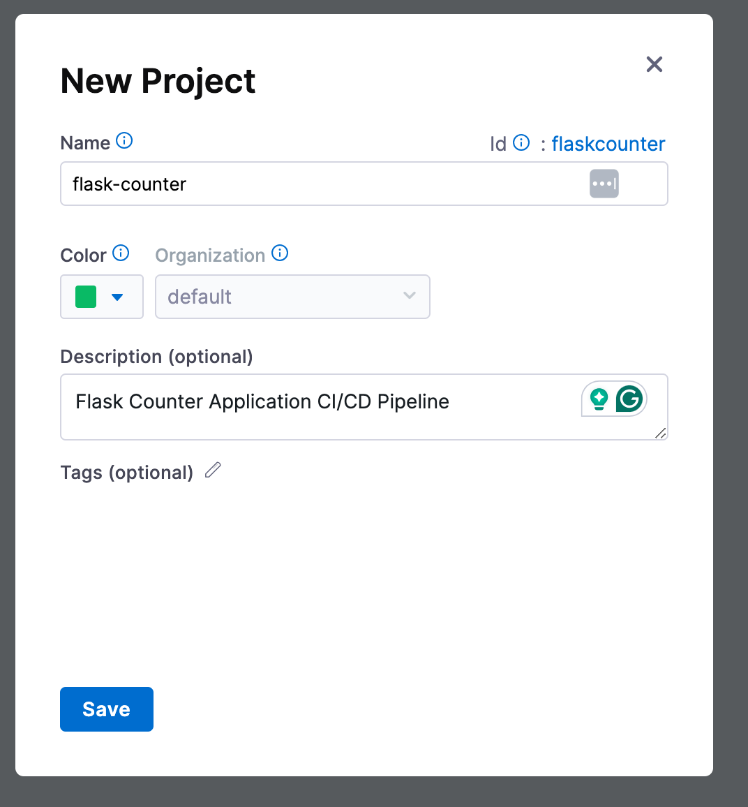

### Install Harness Delegate:
   - In the Harness UI, navigate to Project Settings → Delegates
   - Click "New Delegate"
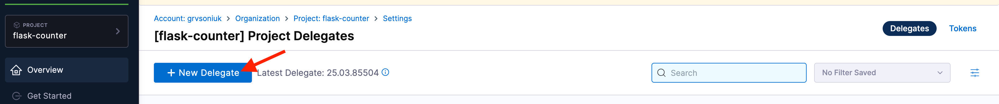
   - Select "Kubernetes" as the delegate type
   - Choose "Helm Chart" as the installation method
   - Copy the provided Helm command:
     ```bash
     helm repo add harness-delegate https://app.harness.io/storage/harness-download/delegate-helm-chart/
     helm repo update harness-delegate
     helm upgrade -i helm-delegate --namespace harness-delegate-ng --create-namespace \
       harness-delegate/harness-delegate-ng \
       --set delegateName=helm-delegate \
       --set accountId=YOUR_ACCOUNT_ID \
       --set delegateToken=YOUR_DELEGATE_TOKEN \
       --set managerEndpoint=https://app.harness.io/gratis/api/ \
       --set delegateDockerImage=harness/delegate:23.07.79904 \
       --set replicas=1 --set upgrader.enabled=false
     ```
   - Replace `YOUR_ACCOUNT_ID` and `YOUR_DELEGATE_TOKEN` with values from the Harness UI
   - Run the command in your terminal
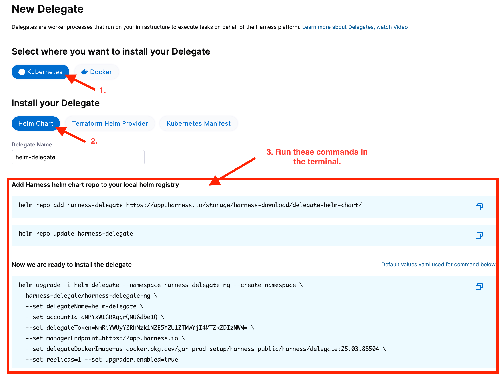

### Verify Delegate Installation:
   - At the bottom of the new delegate page, click 'Verify' button.
     
   - Also, In the Harness UI, check the Delegates page
   - The delegate should show as "Connected" within a few minutes
     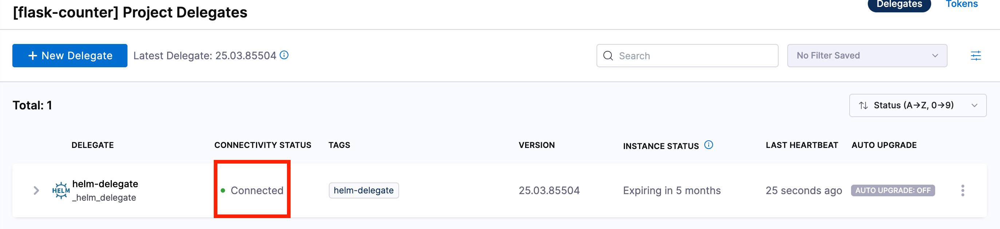
   - Verify the delegate is running in your cluster:
     ```bash
     kubectl get pods -n harness-delegate-ng
     ```
     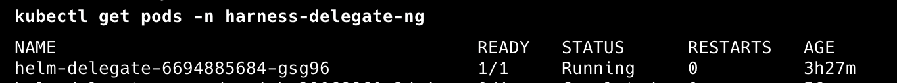

### Delegate Troubleshooting:
   - If the delegate doesn't connect:
     ```bash
     # Check delegate logs
     kubectl logs -n harness-delegate-ng -l harness.io/name=helm-delegate
     
     # Verify delegate pod status
     kubectl describe pod -n harness-delegate-ng -l harness.io/name=helm-delegate
     ```

Now that the delegate is installed, you're ready to create CI/CD pipelines in Harness for your Flask application.

## Creating a CI Pipeline in Harness

1. Navigate to CI Pipeline Creation:
   - In the Harness UI, go to your project
   - Click on "Pipelines" in the left sidebar
   - Click "Create a Pipeline"
   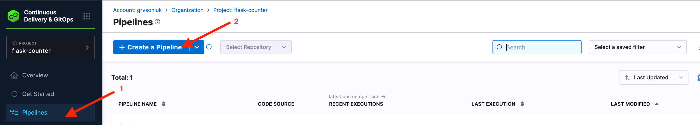
   - Set the details for the pipeline
     - Name : flask-app
     - Description : CI Pipeline for Flask Counter Application
     - Pipeline type : Inline
     - Click 'Start' Button.
   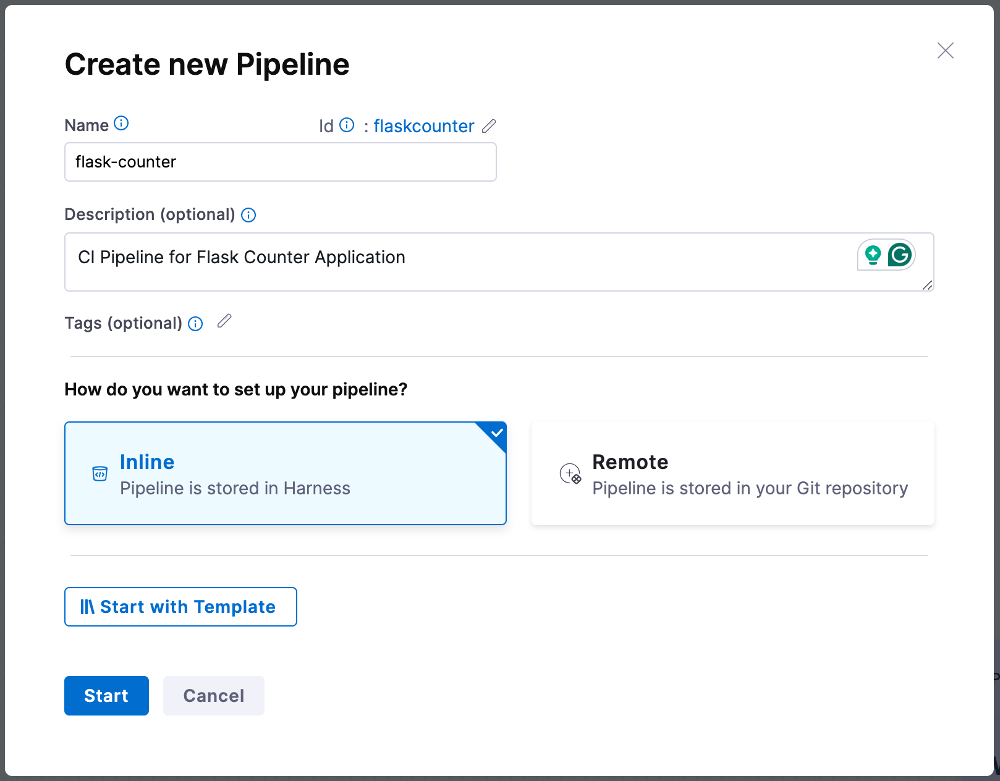
   

2. Add Test Stage:
  - Click "+" to add Stage
  - Select "Build" step type
  - Configure the Test stage:
    - Name : test
    - Select Git provider as 3rd Party.
     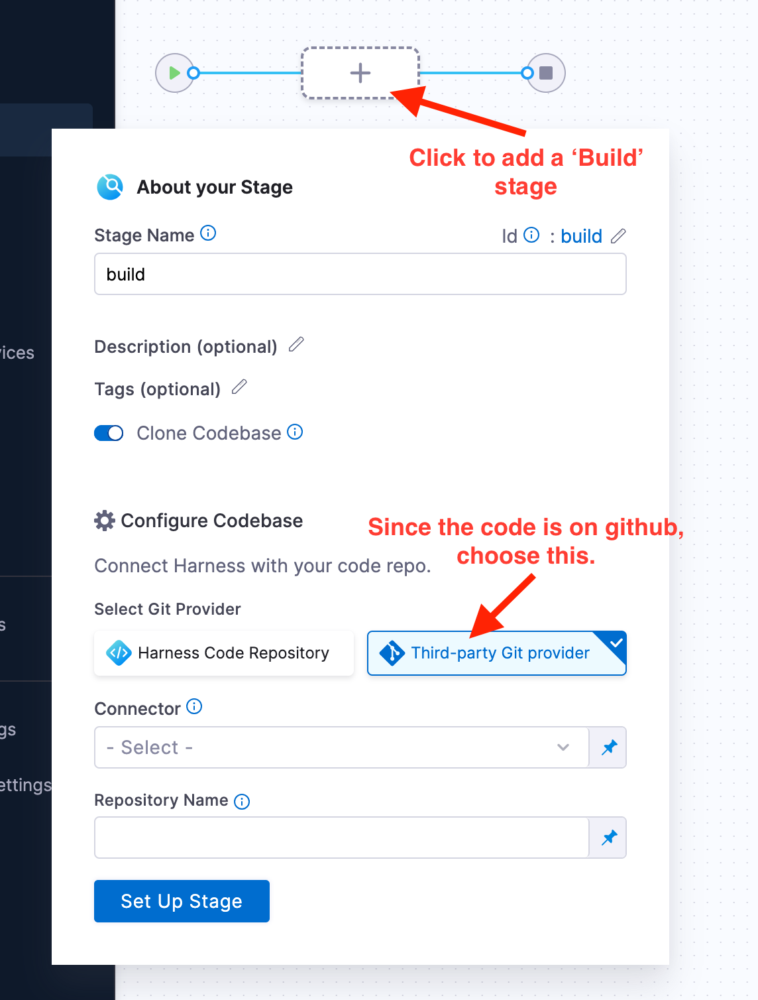
    - To connect to the 3rd party Git provoder, In this case github, you will now need to create a connector.
      - Click connector dropdown. 
      - Click on New connector button in the new popup.
        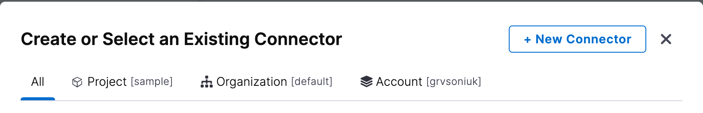
      - Select Github as connector type.
        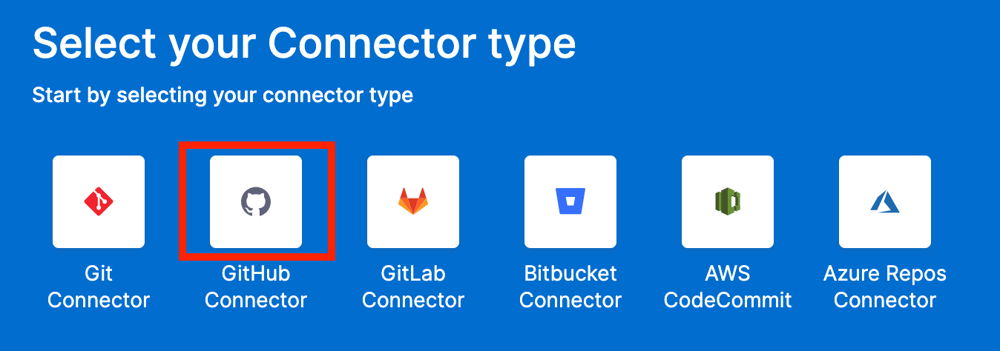
      - In the next popup give a name to the connector and click "Continue".
      - In the Details, provide:
        - URL type: Repository
        - Connection type: HTTP
        - Github Repository URL: `https://github.com/grvsoni/flask-hello.git`
        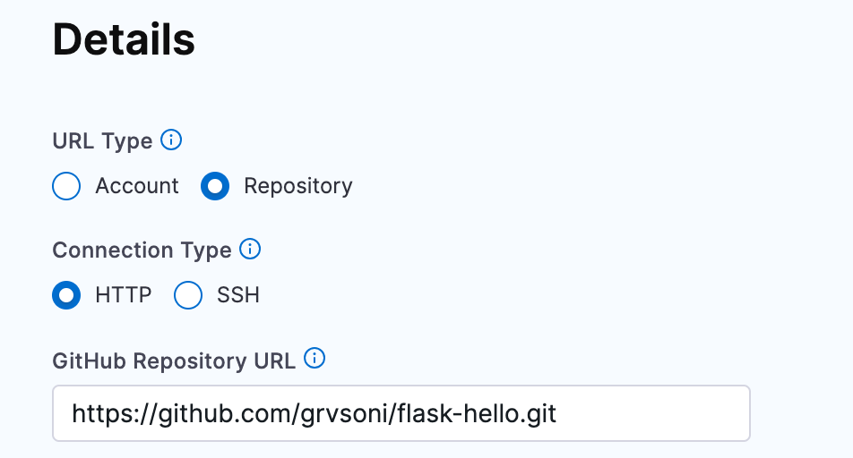
      - In the Connections, provide:
        - Authentication Type: OAuth
        - Click "Link to Github". This will take you to the guthub. Complete the lnk process.
        - Once link is established, Click on the "Continue".
        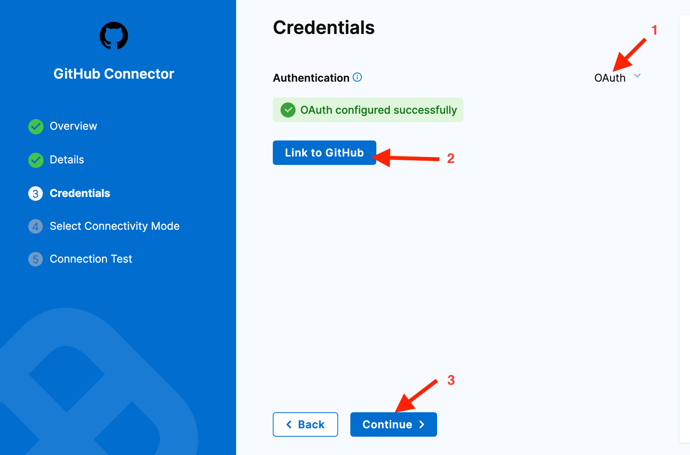
      - In the Connectivity Mode, choose and then click 'Save and Continue'.
        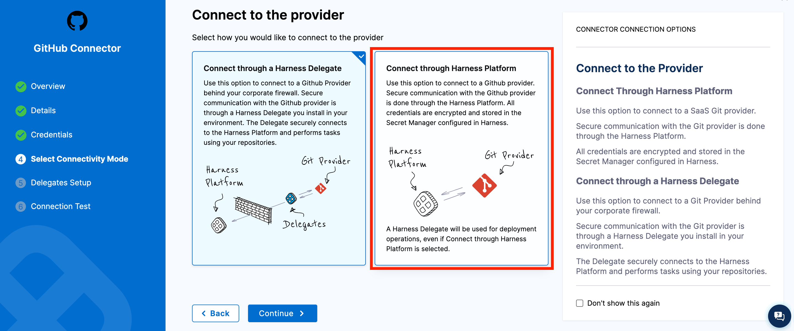
      - Once the connection test succeeds on the next screen, click Finish button.
        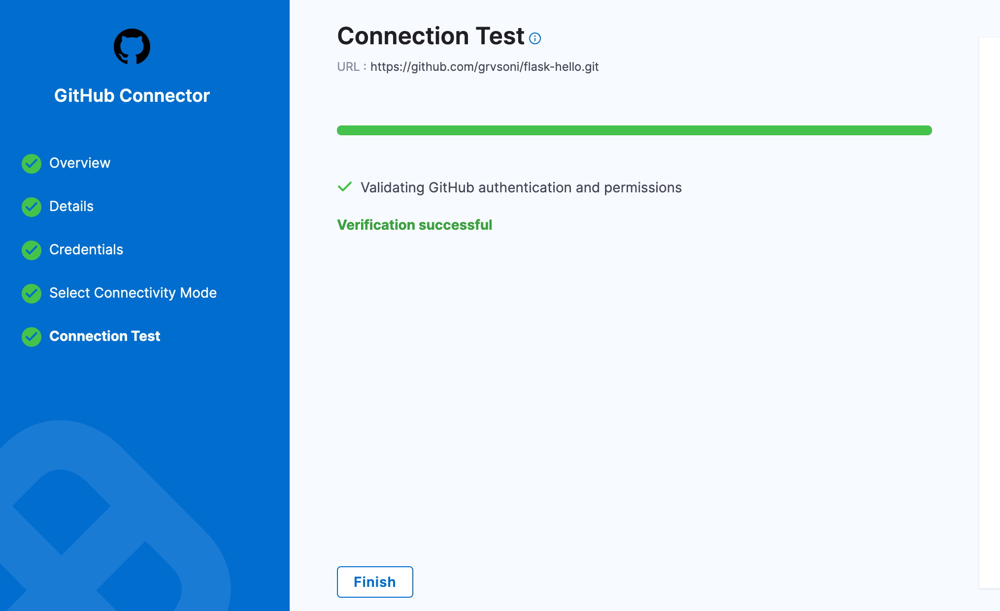
    - Set the Infrastructure to build and test it on Harness cloud.
      - Choose Infrastructure as 'Cloud' and
      - Platform as 'Linux' [AMD64].
      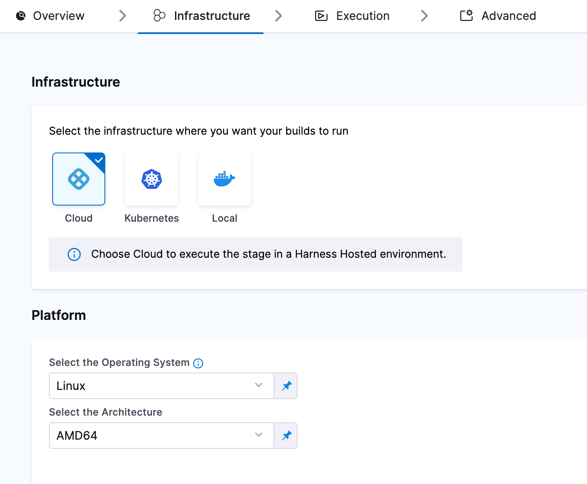
      - Click 'Continue'
    - In the Execution step,
      - Click on the '+' and
      - Click 'Add Step'
      
      - From the step, 
        - Choose Build > Run
        - Name: run_test
        - Shell: Sh
        - and add the code as below
        ```
            pip install -r requirements.txt
            echo "Running tests locally..."
            python -m pytest -v
            if [ $? -ne 0 ]; then
                echo "Tests failed! Aborting build."
                exit 1
            fi
        ```

3. Add Push Stage:
  - Click the next "+" to add Stage
  - Select "Build" step type
  - Configure the Push stage:
    - Name : push
    - Since the git provider is already setup. You will go directly to infrastructure Step.
    - Set the Infrastructure to build and test it on Harness cloud.
      - Choose Infrastructure as 'Cloud' and
      - Platform as 'Linux' [AMD64].
      
      - Click 'Continue'
    - In the Execution step,
      - Click on the '+' and
      - Click 'Add Step'
      
      - From the step, 
        - Choose Build > Run
        - Name: run_push
        - Shell: Sh
        - and add the code as below
        ```
            pip install -r requirements.txt
            ./docker-push.sh
        ```
  - Run the pipeline by clicking the Green Run button on the top right corner.
    <br/><span style="color:red"><b>Challenge 1:</b></span> The push step failed.
    ```
    ...
    denied: requested access to the resource is denied
    ```
    - The same command seems to work on my local but not on the harness cloud.
    - I realised the my script `./docker-push.sh` is not loging into the dockerhub and missing the command below:
      ```
      docker login -u <username> -p <password>
      ```
    - I added the line in the `./docker-push.sh`, and it worked.
    - But as a best practice I do not want to push the username and password as string into my code. I need a way to inject it in more safer way. So I changed my code to use environment variable.
      ```
      docker login -u $DOCKER_USERNAME -p $DOCKER_PASSWORD
      ```
    - Now I need to set the environment varibale in the `run_push` sh script as below:
      ```
        pip install -r requirements.txt
        export DOCKER_USERNAME=<username>
        export DOCKER_PASSWORD=<password>
        ./docker-push.sh
      ```
    - Again, I wanted a better way to inject those values into the environment variable. After exploring, I got to know that we can create stage level variables which can be inject in the scripts like this. 
    - So, to Create a stage variable. 
        - Click the Variable button on the right edge of the Screen.
        
        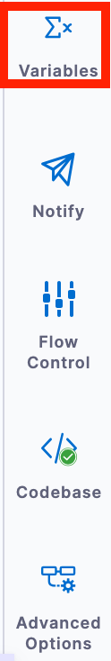
        - Click on the `+ add variable` link at the Stage Push level.
        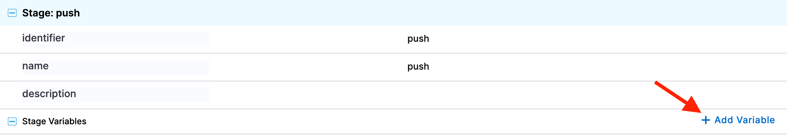
        - Create two variables
          - Name : `username`, Value : `<git_username>`
          - Name : `password`, Value : `<git_password>`
    - Use the variable to inject username and password in environment variable.
      ```
        pip install -r requirements.txt
        export DOCKER_USERNAME=<+stage.variables.username>
        export DOCKER_PASSWORD=<+stage.variables.password>
        ./docker-push.sh
      ```
    - Once this is done. The pipeline seems to work fine. 
    
## Creating a CD Stage in Harness UI.

1. Add CD Stage:
  - In the pipeline editor, click "+" to add a new stage

  - Select "Deploy" as the stage type
    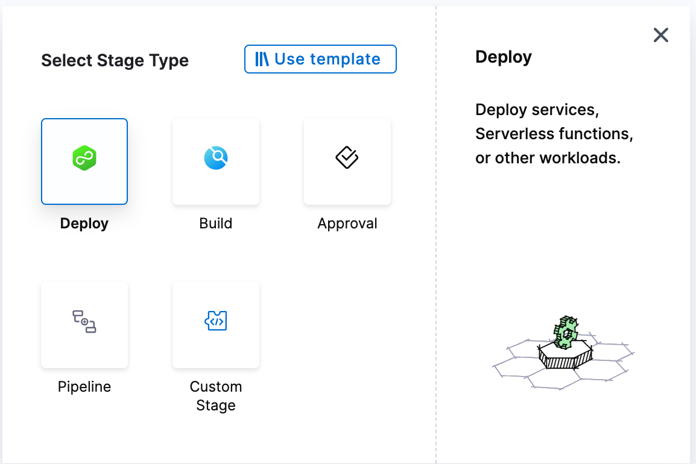

  - Configure the stage:
    - Name: `deploy`
    - Deployment type: k8s
    - Click 'Set Up Stage' button
    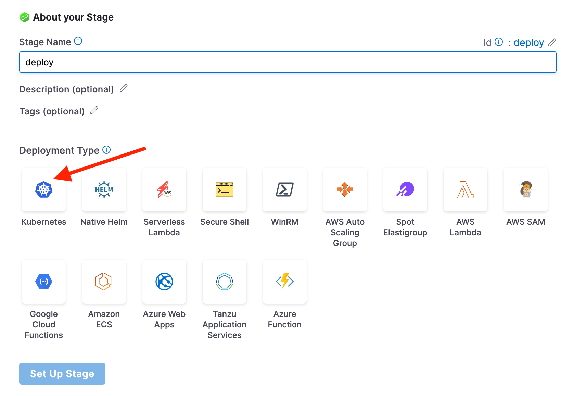

2. Configure Service:
  - Service: Create new
    - Name: `flask-app-service`
    - Deployment Type: `Kubernetes`
    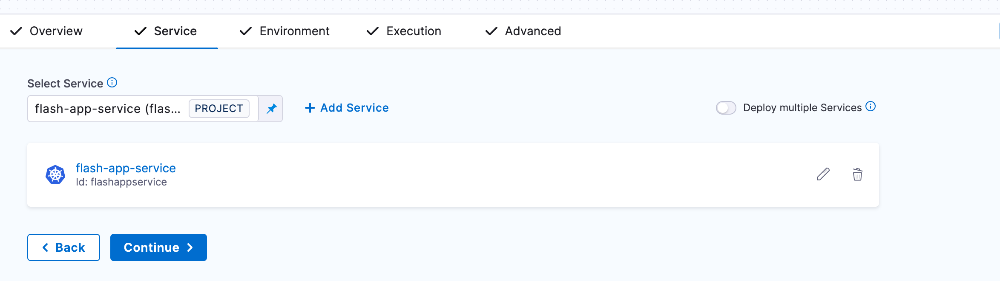
    - In the service configuration:
     - Click "Add Manifest"
     - Select "Kubernetes" as the manifest type
     - Add the following manifests:
       - k8s/deployment.yaml
       - k8s/configmap.yaml
       - k8s/service.yaml
    - Click "Save"
    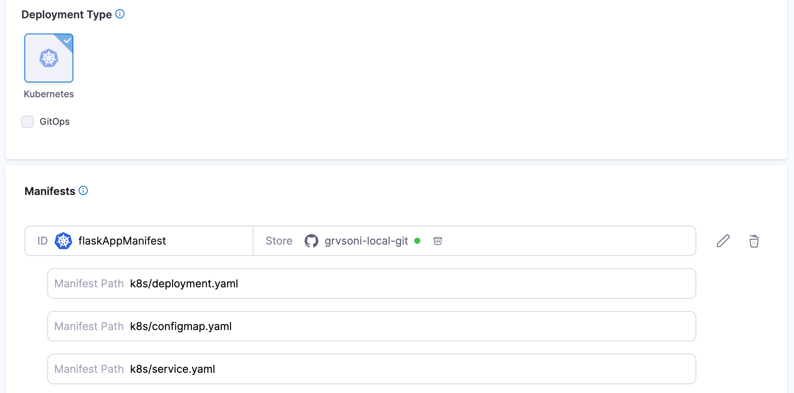
    - Click Continue

3. Configure Environment:
  - Environment: Create new
    - Name: `flask-app-env`
    - Type: `Pre Production`
    - Setup : `Inline`
    - Click "Save"
    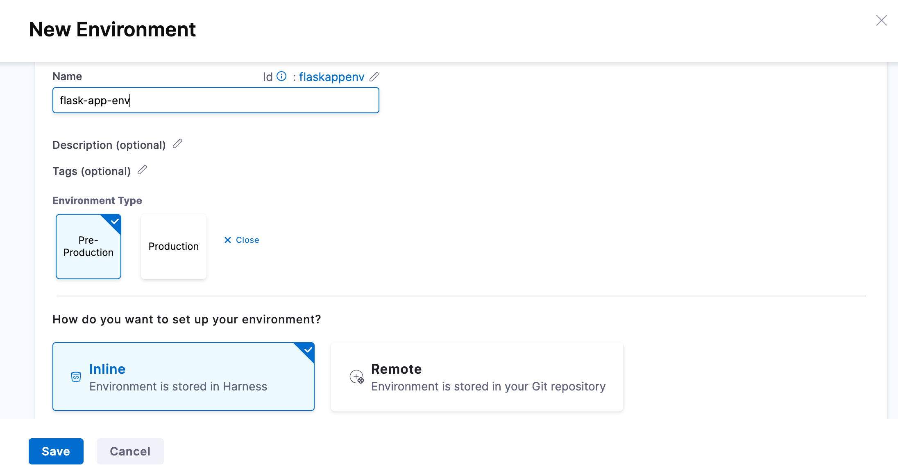
    - Click Continue
  
4. Configure Execution:
   - Click "Add Step"
   - Select "Rolling Deployment" strategy
   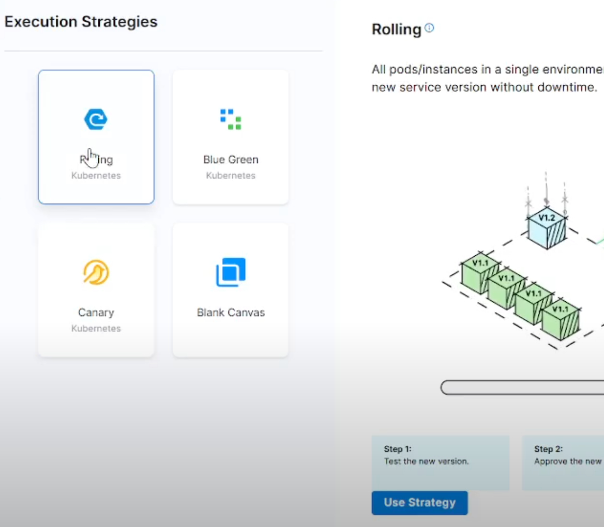
   - Configure the step:
     - Name: `Rollout Deployment`
     - Skip Dry Run: `false`
     - Save

6. Save and Run:
   - Click "Save" to save the pipeline
   - Click "Run" to execute the pipeline
   - Monitor the deployment progress in the Harness UI
   

7. Verify Deployment:
   - Check the deployment status:
     ```bash
     kubectl get pods -n flask-app
     kubectl get svc -n flask-app
     ```
   - Access the application:
     ```bash
     kubectl port-forward svc/flask-counter -n flask-app 3000:80
     ```
   - Open browser and navigate to `http://localhost:3000`

## Setting Up GitHub Trigger

1. Navigate to Triggers:
   - In the pipeline editor, click on "Triggers" tab
   
   - Click "New Trigger"
   

2. Configure Trigger:
   - Type: Select "GitHub"
   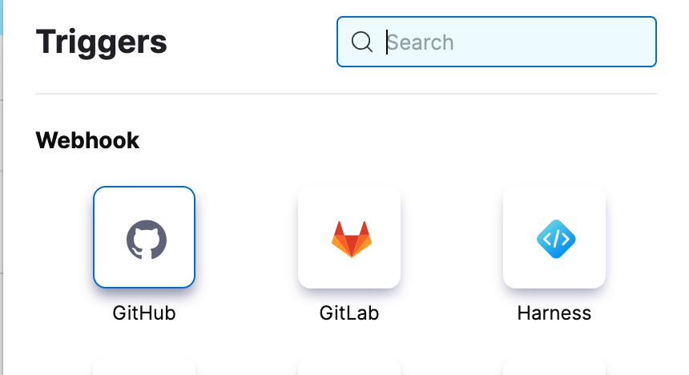
   

3. Configure GitHub Connection:
   - Name: `git-push-triggerr`
   - Repository: Select your GitHub repository (`grvsoni/flask-hello`)
   - Branch: Enter `main`
   - Actions: Select "Push"
   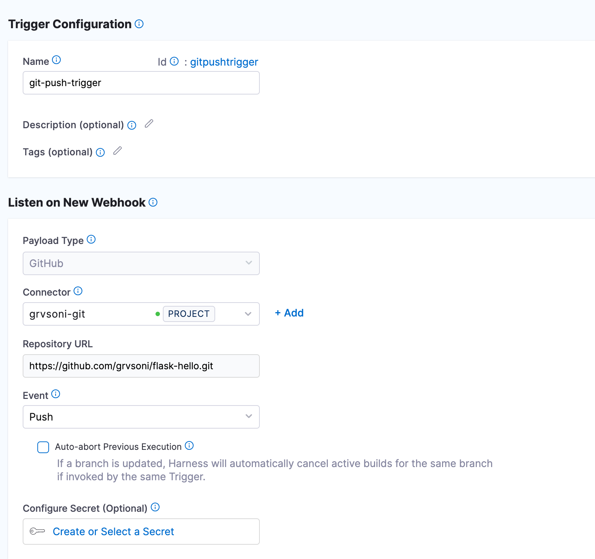

4. Configure Payload Conditions:
   - Click "Add Condition"
   - Select "Branch" condition
   - Operator: `equals`
   - Value: `main`
   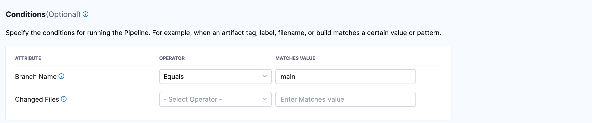

5. Configure Pipeline Input:
   - Click "Pipeline Input" tab
   - Review and confirm the pipeline inputs
   - Click "Continue"
   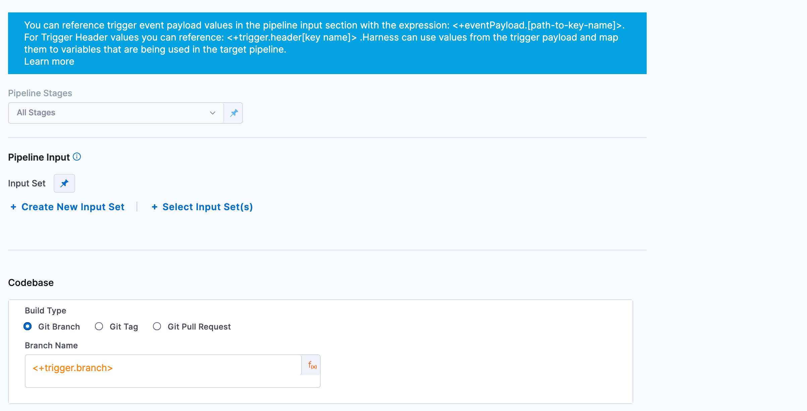

6. Save Trigger:
   - Click "Create Trigger"
   - Verify the trigger is created successfully

7. Test the Trigger:
   - Make a small change to your code
   - Push the changes to the main branch
   - Verify that the pipeline automatically starts
   - Monitor the pipeline execution in the Harness UI
